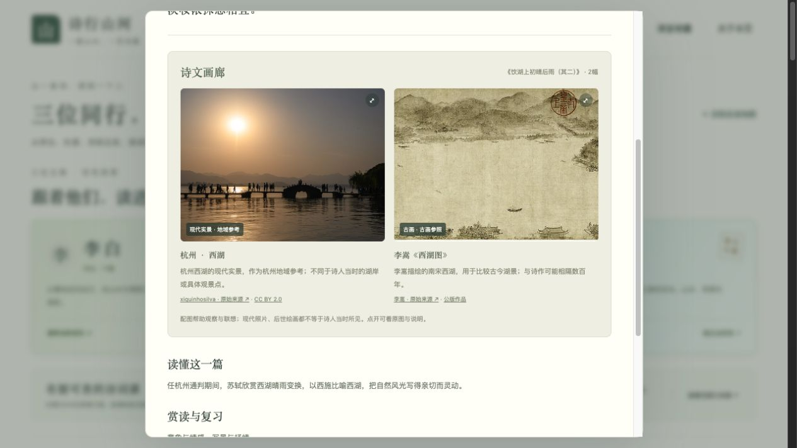
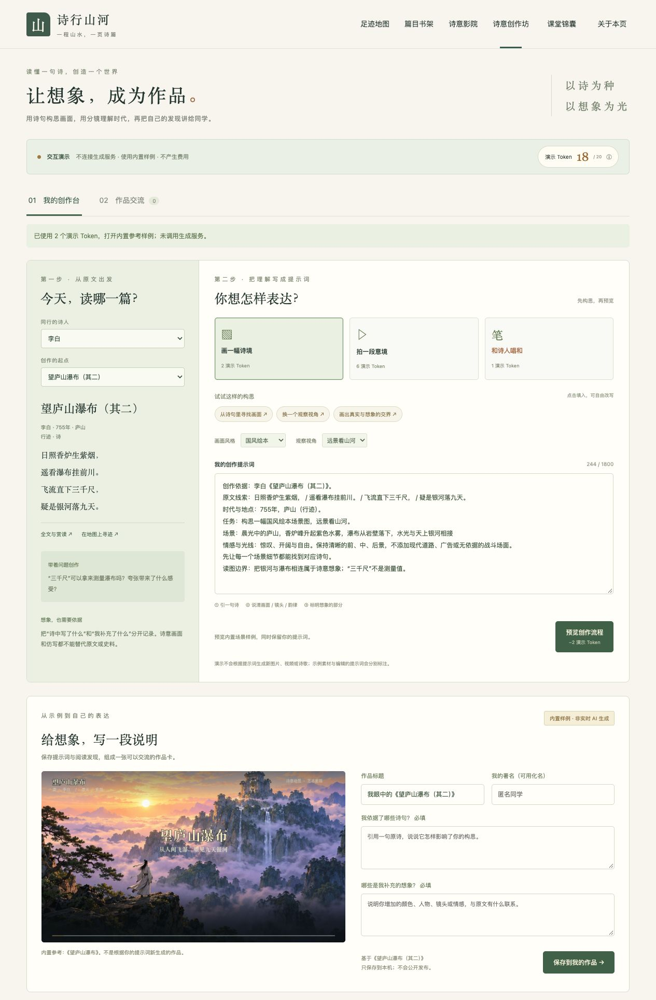
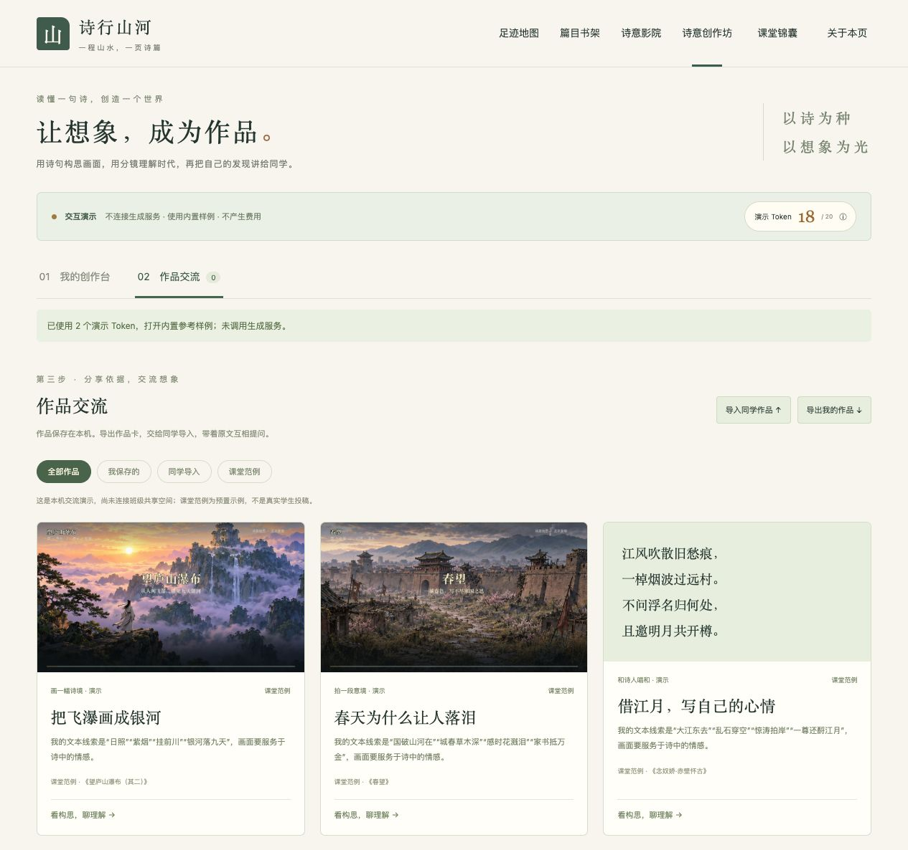

# Shixing Shanhe · 诗行山河

English · [简体中文](README.md) · [Live demo](https://shixing-shanhe.guori12321.chatgpt.site/)

A Chinese-language teaching demo for junior and senior high school students and teachers. Follow **Li Bai, Du Fu, and Su Shi** through places, life events, and the poems associated with them.


## Curriculum library update

The library now contains **215 classical readings**, including every entry in the 2025 revised curriculum recitation appendices: **60 junior-secondary entries and 72 senior-secondary entries**. Composite selections count as one curriculum entry. Additional textbook and older-edition works are labeled separately. Li Bai (13), Du Fu (12), and Su Shi (12) retain prominent featured cards and the original map routes. Other readings do not receive invented dates or locations.

Filter by stage, author, genre, curriculum course, source, or full text. All readings link to the interactive creation demo. Recitation appendices do not define every possible regional exam or unseen reading question. See the [coverage manifest, sources, and corrections](docs/CURRICULUM_COVERAGE.md). Dataset arrangement follows [CC BY-SA 4.0](dist/assets/catalog/LICENSE-CC-BY-SA-4.0.txt), with [attribution](dist/assets/catalog/attribution.json).

## Illustrated readings

All 215 readings now have two curated image placements, reusing 30 photographs, historical paintings, and imagery references. Map visits, library covers, and full-text galleries share the same per-work choices. Each image states its source, author, date, licence, and relationship to the text. Regional references, later paintings, and imagery from other locations are explicitly distinguished. No reference image is treated as an authenticated writing location. Image choices and assets are separate editable manifests; see the [replacement guide](docs/POEM_IMAGES.md).



## Features

- **Travel map:** ready-made OpenFreeMap Bright cartography and real Mapterhorn elevation rendered in MapLibre, with rotation, tilt, a flat view, route overview, and close-up terrain at each stop. Route arrows, sequence numbers, and existing work dates show the order of selected stops; click an arrow or year to read the destination work. Approximate dates remain approximate. Modern roads, buildings, and unrelated place labels are hidden to emphasize the poet’s route and relevant literary landmarks. Explore by poet, location, and timeline. Each stop includes the full text, background, reading prompts, and classroom questions. Documented travel, locations mentioned in poems, and uncertain locations are distinguished.
- **Poetry library:** a dedicated page with 215 readings. Featured sections highlight Li Bai (13), Du Fu (12), and Su Shi (12). Filter by author, stage, genre, course, source, or full text; hide texts for memorization. The three featured poets retain map-stop links; other authors use the reading library.
- **Historical frontier context:** an optional, normally hidden layer uses sparse purple dashed schematic lines for three dated regional frontier settings. Three frontier poems link to a separate reading context. These original teaching schematics are partial and approximate, not exact national borders; sources and limits are visible.
- **Poetry cinema:** three narrated films of about one minute each. Relevant map stops show a film cover; playback starts on click. Includes synthesized Mandarin narration, original synthesized music, Chinese subtitles, scene navigation, fullscreen, and downloads.
- **Rivers, lakes, and literary landmarks:** restyled public-domain Natural Earth geometry adds selected segments of 11 rivers, 3 lakes, and 10 landmark references. Toggle layers independently and open related works where available. Modern water geometry and regional landmark markers do not add travel stops. See the [map sources and selection notes](docs/MAP_SOURCES.md) (Chinese).
- **Present-day photography:** locations include Lushan waterfall, Yellow Crane Tower, Baidi City, Du Fu’s cottage, West Lake, Jianmen Pass, Mount Tai, and Huangzhou. Historical paintings and imagery references extend the galleries; all images carry individual source and licence notes.
- **Poetry creation studio (interaction demo):** all 215 readings can seed editable prompts for scene art, video storyboards, and poetry imitation. Includes resettable demo credits, evidence and imagination notes, local portfolios, JSON exchange, and local peer feedback. Uses built-in reference assets; no live model calls, paid usage, or online classroom publishing. See [studio notes](docs/CREATION_STUDIO.md) (Chinese).
- **Consistent navigation:** map, library, cinema, creation studio, teaching tips, and project information. The homepage focuses on the map and the selected poem.

The application UI and teaching content are in Chinese; this README provides an English project guide.

## Screenshots

### Searchable poetry library


### Dedicated cinema page


### Narrated film player


| Work | Poet | Duration | Scenes |
| --- | --- | --- | --- |
| 望庐山瀑布 · Viewing the Waterfall at Mount Lu | Li Bai | 60 s | Purple mist, waterfall, the Milky Way |
| 春望 · Spring View | Du Fu | 62 s | Chang’an in spring, war, letters from home |
| 念奴娇·赤壁怀古 · Remembering the Past at Red Cliff | Su Shi | 66 s | River, waves, imagined Zhou Yu, moonlight |

## Source-attributed classroom activities

The teaching-tips dialog includes six activities, filtered by school stage, with guiding questions, step-by-step tasks, student outputs, checklists, and downloadable student worksheets. Methods are paraphrased from public school and university teaching reports and an education resource platform; source methods and this project’s adaptations are labeled separately. Relevant map stops and reading dialogs link to the activities. See the [teaching source and adaptation notes](docs/TEACHING_SOURCES.md) (Chinese).


## Run locally

The website uses plain HTML, CSS, and JavaScript. There is no build step, database, or runtime API key. Use Python 3 or another static HTTP server.

```bash
git clone https://github.com/guori12321/shixing-shanhe.git
cd shixing-shanhe
python3 -m http.server 5173 --directory dist
```

Open <http://localhost:5173>. Serve over HTTP rather than opening HTML files directly, because the map loads a local JSON file with `fetch`.

| Page | Local URL |
| --- | --- |
| Map | http://localhost:5173/index.html |
| Library | http://localhost:5173/library.html |
| Cinema | http://localhost:5173/videos.html |
| Example work link | http://localhost:5173/index.html?work=lb-lushan |

To deploy, upload the **contents of `dist/`** to a static website host. The documentation screenshots and media production scripts are not runtime dependencies. Playable films are included, so media generation is optional.

## Structure and maintenance

```text
dist/                    Deployable static website
  index.html             Travel map homepage
  library.html           Dedicated poetry library
  videos.html            Dedicated cinema
  site-nav.js            Shared navigation and information dialogs
  poetry-data.js          Base works, poets, and travel data
  curriculum.js          Additional works and learning metadata
  map.js                 Third-party terrain map, route lines, and city pins
  geography.js           Water, landmarks, layer controls, and related works
  app.js                 Timeline and stop details
  library.js             Filters, reading, and curriculum notes
  cinema.js              Film catalog and playback
  teaching.js            Sources and six adapted classroom activities
  assets/                Map, photographs, films, posters, subtitles
docs/screenshots/        README screenshots
media-production/       Production scripts, storyboards, prompts, timings
CURRICULUM_AUDIT.md      Curriculum audit and sources (Chinese)
```

When editing a work or location, retain its location type and uncertainty notes. Update shared navigation in `site-nav.js`. Media production requires additional Python packages, ffmpeg, and fonts; see the [production notes](media-production/README.md).

## Educational scope and historical limits

The full reading library covers all 60 junior and 72 senior classical-recitation entries in the 2025 revised curriculum appendices. The three featured poets account for 8 junior and 11 senior entries. Additional textbook selections remain separately labeled. Regional exam requirements and unseen reading materials vary; teachers should consult their local requirements. See the [full coverage audit](docs/CURRICULUM_COVERAGE.md).

The map uses OpenFreeMap cartography and Mapterhorn DEM elevation, rendered with MapLibre GL JS 5.15.0 at 1.5× terrain exaggeration. It is not a surveying tool. Map tiles, elevation, and fonts require Internet access, without an API key. Availability depends on external public services; mainland China classroom connectivity has not been verified. Coordinates and map content are modern. Route lines indicate the order of selected travel stops, not historical roads or Tang/Song boundaries. Dates and locations can be disputed. Huangzhou Red Cliff is distinct from the commonly identified battlefield; the Zhou Yu sequence illustrates the poem’s historical imagination.

## Sources and licensing

- Classical texts are ancient public-domain works; teaching commentary was written for this demo.
- Photographs and painting reproductions come from Wikimedia Commons. See the [new image credits](dist/assets/poem-images/credits.json), [editable asset manifest](data/poem-image-assets.json), and [original five-photo credits](dist/assets/photos/credits.json). Individual CC BY, CC BY-SA, CC0, and public-domain terms continue to apply. Cards crop previews; the viewer shows the complete bundled composition.
- Film illustrations are AI-generated artistic interpretations, animated as illustrated scenes. Mandarin narration uses the synthesized `zh-CN-YunxiNeural` voice; music and ambience are generated by code. These are not human recordings or historical footage. Prompts and scripts are included in the production directory.
- Cartography: [OpenFreeMap](https://openfreemap.org/) / OpenMapTiles / [OpenStreetMap (ODbL)](https://www.openstreetmap.org/copyright). Elevation: [Mapterhorn and upstream open data](https://mapterhorn.com/attribution/). Engine: MapLibre GL JS (BSD-3-Clause; bundled license in `dist/vendor/maplibre/LICENSE.txt`). Keep on-map attribution.
- The exploration concept was inspired by [DeanChensj/jiangshan-map](https://github.com/DeanChensj/jiangshan-map). This project’s interface and implementation were written independently.

No single open-source license has been assigned to all repository content. Public availability does not grant unrestricted relicensing; third-party assets retain their own terms.

### Creation studio demo




