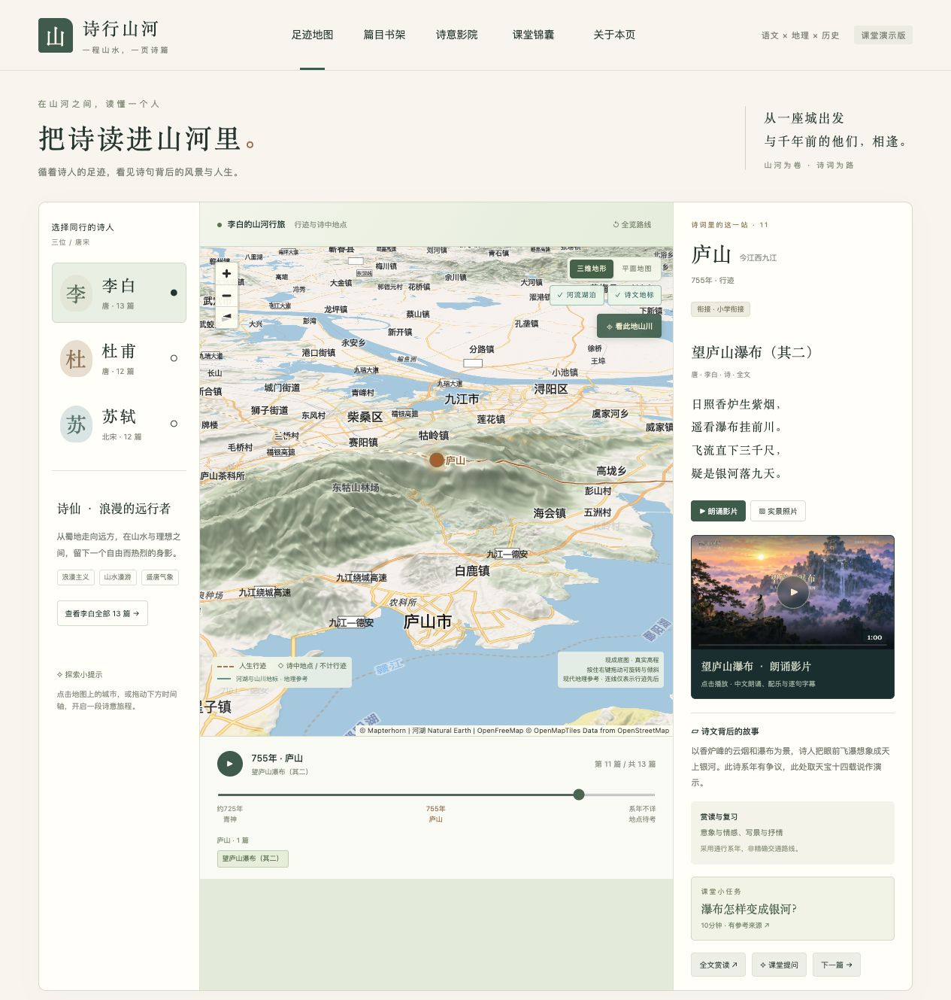
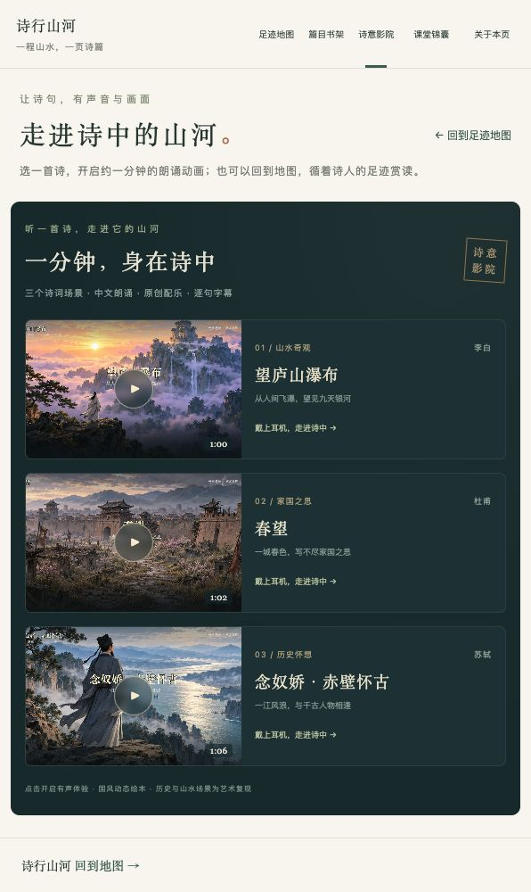
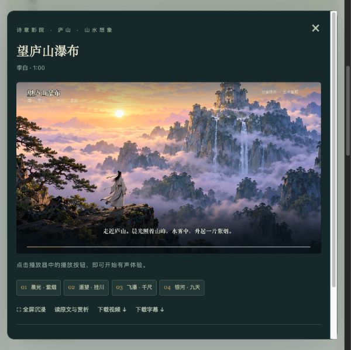

# 诗行山河 · Shixing Shanhe

[English](README.en.md) · 简体中文 · [在线演示](https://shixing-shanhe.guori12321.chatgpt.site/)

面向初、高中师生的中文诗词教学演示。循着李白、杜甫和苏轼的行迹，把地点、人生故事与诗文串起来。



## 功能

- **足迹地图**：复用 OpenFreeMap Bright 现成底图与 Mapterhorn 真实高程，MapLibre 展示可旋转、倾斜的三维山川，可切换平面地图、全览路线或近看当前站点；按诗人、地点和时间探索；显示当前站点的诗文全文、背景故事与课堂提问。区分可定位行迹、诗中地点和待考地点，连线仅为精选行迹的先后示意。
- **篇目书架**：独立页面收录37篇诗词与古文（李白13、杜甫12、苏轼12），支持作者、学段、来源分类和关键词筛选、遮文背诵，以及返回对应地图站点。
- **诗意影院**：独立页面收录三段约一分钟的朗诵影片。对应站点显示影片封面，点击后才播放；配中文合成朗诵、原创合成配乐、逐句字幕、场景跳转、全屏及下载。
- **河湖与诗文地标**：复用 Natural Earth 公版矢量线形，加入11条河流的选取线段、3个湖泊与10处地标。图层可独立开关，部分要素可联动作品；现代概化河道与区域地标不计入诗人行迹。详见 [地图来源与选型](docs/MAP_SOURCES.md)。
- **当代实景照片**：庐山瀑布、黄鹤楼、白帝城、杜甫草堂和西湖，附作者、日期与授权来源。
- **统一导航**：地图、书架、影院、课堂锦囊、关于本页；首页聚焦地图与当前诗文。

## 界面截图

### 篇目搜索


### 诗意影院



### 有声影片



| 作品 | 作者 | 时长 | 场景 |
| --- | --- | --- | --- |
| 望庐山瀑布 | 李白 | 60秒 | 紫烟、飞瀑、银河 |
| 春望 | 杜甫 | 62秒 | 长安春色、烽火、家书 |
| 念奴娇·赤壁怀古 | 苏轼 | 66秒 | 大江、惊涛、周瑜想象、江月 |

## 参考课例的课堂任务

“课堂锦囊”现提供六项按学段筛选的活动，包含主问题、分步任务、学生产出、检查要点和学生任务单下载。参考了教育资源平台、学校与大学公开教研报道；每项均区分参考方法与本站改编。相关站点和全文赏读有对应入口。详见 [教学参考与改编记录](docs/TEACHING_SOURCES.md)。


## 本地运行

网站使用原生 HTML、CSS 和 JavaScript，无构建步骤、数据库或运行时 API 密钥。需要 Python 3 或其他静态文件服务器。

```bash
git clone https://github.com/guori12321/shixing-shanhe.git
cd shixing-shanhe
python3 -m http.server 5173 --directory dist
```

打开 <http://localhost:5173>。请通过 HTTP 访问，避免直接双击 HTML 导致地图 JSON 读取受限。

| 页面 | 本地地址 |
| --- | --- |
| 足迹地图 | http://localhost:5173/index.html |
| 篇目书架 | http://localhost:5173/library.html |
| 诗意影院 | http://localhost:5173/videos.html |
| 指定作品示例 | http://localhost:5173/index.html?work=lb-lushan |

部署时将 **`dist/` 的内容**上传到静态网站托管服务即可；截图文档与制作脚本不属于网站运行依赖。仓库已经包含可播放的影片，无需重新生成媒体。

## 项目结构与维护

```text
dist/                    静态网站，可直接托管
  index.html             行迹地图首页
  library.html           独立篇目书架
  videos.html            独立影院
  site-nav.js            三个页面共用的导航与说明弹窗
  poetry-data.js          基础作品、作者与行迹数据
  curriculum.js          补充作品及学习元数据
  map.js                 第三方三维地图、行迹连线与城市标记
  geography.js           河湖、地标、图层开关与作品关联
  app.js                 时间轴与站点详情
  library.js             筛选、全文赏读与课标说明
  cinema.js              影片目录与播放器
  teaching.js            教学来源与六项改编活动
  assets/                底图、照片、影片、封面和字幕
docs/screenshots/        README 界面截图
media-production/       影片制作脚本、分镜、提示词和时间清单
CURRICULUM_AUDIT.md      课标核对记录与参考来源
```

修改作品与行迹时，请保留地点角色、约年及不确定性说明；修改导航请使用 `site-nav.js`。影片制作需要额外的 Python 依赖、ffmpeg 和字体，详见 [制作记录](media-production/README.md)。

## 教学范围与资料来源

对照2025日常修订版课标，仅核对这三位作者：初中8篇、高中11篇，均已收录。**不代表覆盖其他作者、各地全部考题或课外鉴赏材料**。使用时请结合当地考试年份、学校教材和注本；系年、异文及地望可能有不同说法。详见 [核对记录](CURRICULUM_AUDIT.md)。

地图采用 OpenFreeMap 现成制图和 Mapterhorn DEM 高程，由 MapLibre GL JS 5.15.0 渲染；三维模式高程夸张系数为1.5，不用于测量。地图、字体和高程瓦片需联网加载，无需 API 密钥；公共服务无本站控制的可用性保证，中国大陆课堂网络尚待实测。地图是现代地理参考，非唐宋疆域或精确交通路线。黄州赤壁不等同于通常认定的赤壁之战古战场；周瑜场景属于词中的怀古想象。

## 素材与许可说明

- 古典作品为古代公版文本；教学说明为本演示编写。
- 实景照片来自 Wikimedia Commons，具体作者、作品链接及各自的 CC BY / CC BY-SA 授权见 [photos.js](dist/photos.js) 与 [原始署名记录](dist/assets/photos/credits.json)。照片经过尺寸适配，界面有裁切展示；相关素材仍适用各自原许可。
- 影片绘画由 AI 生成，属于动态绘本式艺术复现；朗诵使用 `zh-CN-YunxiNeural` 合成语音，配乐和环境声由程序生成，非真人录音或历史影像。生成提示词与脚本保存在制作目录。
- 底图：[OpenFreeMap](https://openfreemap.org/) / OpenMapTiles / [OpenStreetMap（ODbL）](https://www.openstreetmap.org/copyright)；高程：[Mapterhorn 及上游开放数据](https://mapterhorn.com/attribution/)；引擎：MapLibre GL JS（BSD-3-Clause，许可附于 `dist/vendor/maplibre/LICENSE.txt`）。页面保留地图署名。
- 交互方式参考 [DeanChensj/jiangshan-map](https://github.com/DeanChensj/jiangshan-map)，本项目界面与实现独立编写。

本仓库未为全部内容指定统一的开源许可证；公开可见不等同于无限制再许可。第三方素材按其各自条款使用。
